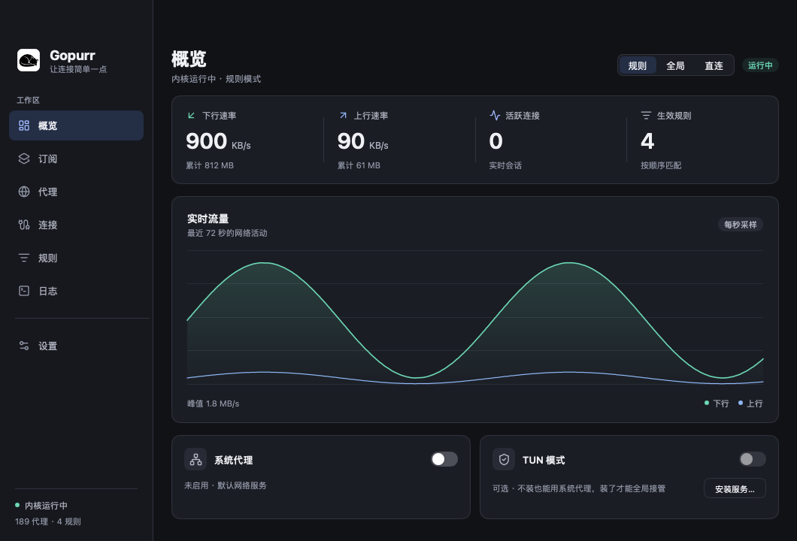
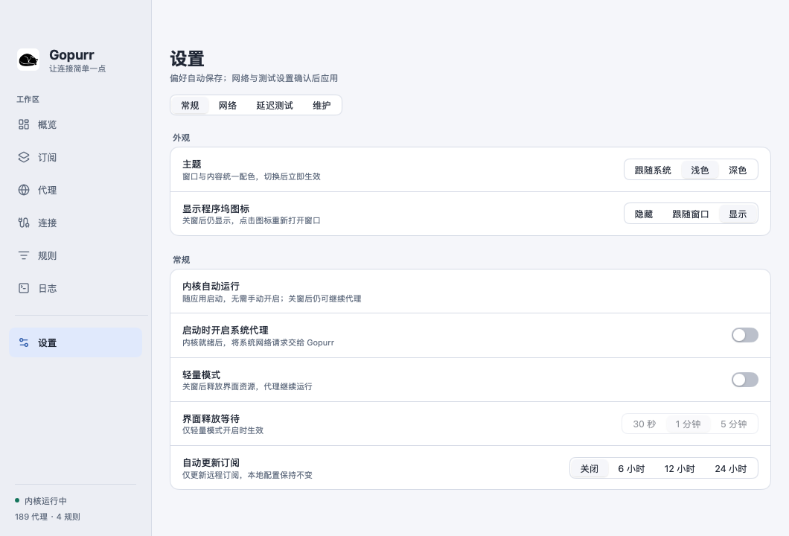
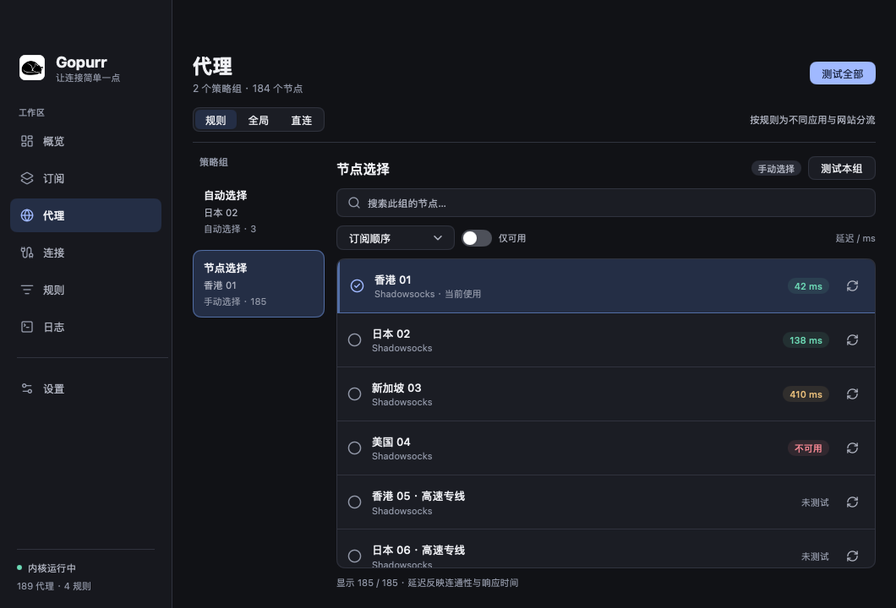
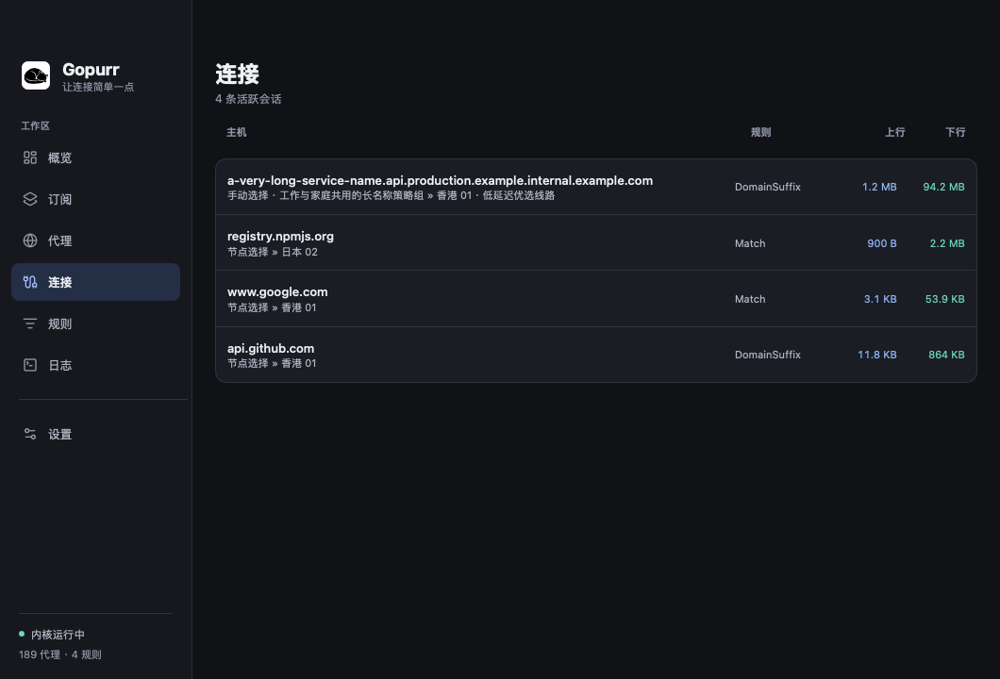
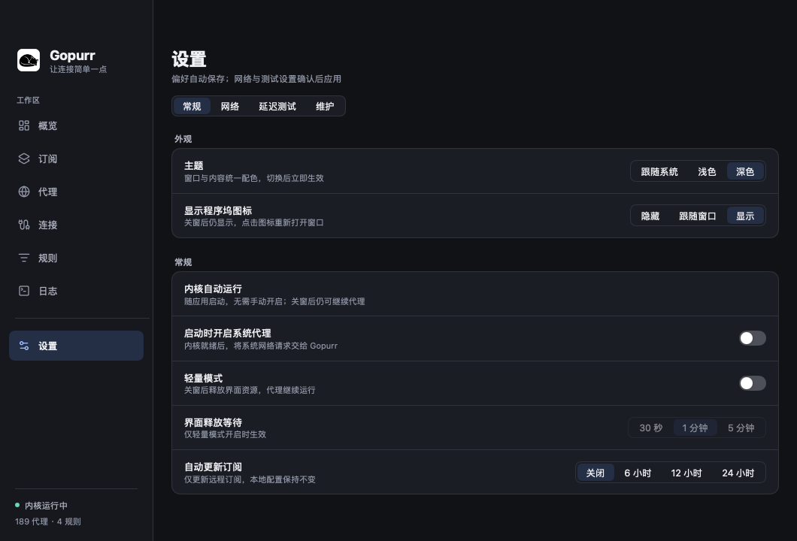
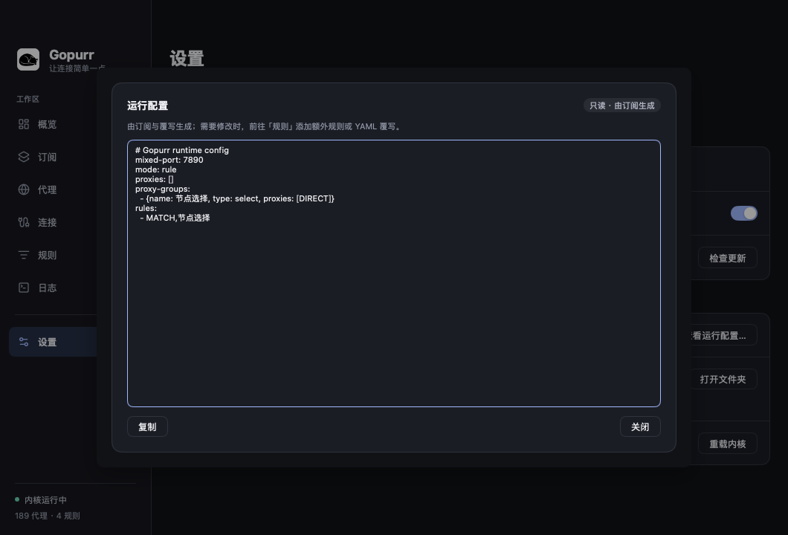

<p align="center">
  
</p>

# Gopurr

**Gopurr**：盘起的猫身与字母 G 融合成一个标记。米白色轮廓与深蓝底用于侧栏、Dock 和应用图标，菜单栏使用随系统明暗变化的单色版本。

[mygo](https://github.com/egoist/mygo) 原生界面的 mihomo 桌面客户端：**内核跑在独立的守护进程里，界面只通过 unix socket 说 mihomo 的标准控制器协议**。没有 WebView，没有 TCP 控制端口，也没有自己发明的提权链路。



## 安装与更新

从 [GitHub Releases](https://github.com/csic21/Gopurr/releases/latest) 下载：

| 平台 | 安装包 | 安装方式 |
| --- | --- | --- |
| macOS Apple Silicon（M1 及后续 M 系列） | `gopurr-版本-arm64.dmg` | 打开后拖入 Applications |
| Windows 10/11 x64 | `gopurr-setup-版本-amd64.exe` | 按安装向导安装到当前用户目录 |

「设置 → 维护 → 软件更新」或托盘菜单可手动检查更新。默认每天检查新版本，展示更新说明，经确认后下载；更新器使用固定公钥校验 Ed25519 签名，再安装并提示重启。关闭窗口不影响检查，退出应用会取消在途下载。订阅、规则与设置保存在应用包以外，软件更新会保留这些数据。

两个平台都支持 TUN：macOS 使用 LaunchDaemon，Windows 使用 SCM 系统服务与内嵌 Wintun 驱动。概览页点击「安装服务…」，阅读说明后授权；软件更新后若服务版本落后，会显示「重新安装…」，再次授权即可升级服务内核。Windows 服务使用 Program Files 下的受保护副本，普通界面仍以用户身份运行。

首次版本尚未配置 Apple Developer ID／公证和 Windows Authenticode 证书，系统可能提示无法验证开发者。安装说明见 [发布说明](docs/release-notes.md)。应用更新包的 Ed25519 签名已独立配置。

发布工作流和签名密钥管理见 [发布流程](docs/releasing.md)。

## 架构

```
Gopurr（用户态）                        Gopurr --core（守护进程）
  ├─ 原生 UI（GPU 直接画）                 ├─ hub.Parse 自己的配置
  ├─ 订阅 / 覆写 / 系统代理                ├─ TUN、路由、DNS 由 mihomo 自己做
  ├─ REST over unix socket ──────────────▶ ├─ external-controller-unix
  └─ TUN → LaunchDaemon / Windows Service   └─ SIGTERM 退出
```

- **协议是公开的**：`/traffic`、`/logs`、`/connections`、`/proxies`、`/rules`、`/configs`，就是每个 Clash 面板都在用的那套。
- **权限边界干净**：守护进程只做一件事——按配置跑内核。它不接受“帮我加这条路由”“帮我改 DNS”这种指令，配置是数据不是命令。
- **TUN 不需要自己实现路由**：`tun.auto-route` 由 mihomo 负责，换网、IPv6、排除列表都跟着上游走。
- **谁拥有内核谁就有权限**：日常（不开 TUN）由应用拉起一个同用户子进程；要 TUN 时安装 macOS LaunchDaemon 或 Windows 系统服务，之后应用只连它的 socket。

## 两种运行方式

**日常模式**（零提权，默认）

```sh
make run
```

应用启动时默认拉起 `--core` 子进程，无需手动启动内核。父子关系决定生命周期：应用退出（甚至崩溃），子进程跟着走。系统代理、订阅、测速、规则、日志都在这个模式下可用。系统代理由用户选择是否开启；设置里的“启动时开启系统代理”可以在之后启动时自动启用。`GOPURR_AUTOSTART=0` 只用于调试时禁用默认启动。

macOS 应用包（含 Finder 图标）：`make bundle`，产物为 `bin/darwin-arm64/Gopurr.app`（发布只支持 Apple Silicon）。图标渲染源文件是 `internal/brand/icon-master.png`，平面与菜单栏版本是 `logo.svg` 与 `tray.svg`；修改后运行 `make icons` 更新内嵌图标，`make preview-icons` 生成明暗背景和实际使用尺寸检查图。当前采用纯白底与纯黑蜷睡猫剪影，修改矢量设计后可用 `make brand-master` 重绘渲染稿；详见 [品牌素材说明](internal/brand/README.md)。

**TUN 模式**（可选，需要一次授权）

TUN 要 root 建 utun 和改路由，macOS 没有别的办法。做法和 Clash Verge 一致：用户主动点"安装服务"，一次管理员授权，之后常驻。

- 概览页 → TUN 卡片 → **安装服务…** → 确认框写明会写哪个 plist、为什么需要 root、怎么卸载 → macOS 授权 → 完成
- 卸载：同一张卡片的 **卸载服务**，也走确认框
- 手工安装（等价，便于排查）：

```sh
./bin/Gopurr                      # 先跑一次，生成 runtime.yaml
sudo ./scripts/install-daemon.sh   # 或 sudo sh internal/service/install.sh install <bin> <dir>
```

安装后应用会直接使用这个 root 守护进程；`IsRoot()` 为真时 TUN 开关才可用。macOS 由 launchd、Windows 由 SCM 管理其生命周期，应用不会去 kill 它。**没装服务时，TUN 开关是灰的，并写明原因，不影响其他功能。**

## 界面

原生控件，没有 WebView。支持「跟随系统 / 浅色 / 深色」，在「设置 → 常规 → 外观」切换并自动保存，默认跟随系统。窗口顶部与侧栏、内容区使用一致的配色，保留原生窗口按钮、拖动与全屏行为；系统外观变化时自动更新，无需重启。浅色使用柔和灰白与深蓝强调色，深色使用石墨灰与浅蓝强调色，**同一套调色板也用于 mygo 的控件主题**，覆盖对话框、输入框、开关和按钮。正文、辅助文字与选择态分别检查对比度。字体、间距、图标及截图验收要求见 [UI 规范](DESIGN.md)。





几处细节：

- 侧边栏用 mygo 的 `Sidebar` + `SidebarItem`，导航与动作统一使用内嵌的 Lucide SVG；未选中图标保持中性，选中态、悬停态和键盘方向键保留原生行为。
- 流量图用 `chart` + `Painter` 直接画：单调曲线、渐变填充、网格线、上下行两条曲线。
- 延迟用色阶标签（<200ms 绿 / <500ms 黄 / 超时红）；当前节点同时显示勾选、文字和浅蓝底色。
- 指标按组展示；连接和节点列表使用统一容器与行间分隔。空状态、列头、卡片和状态标签使用共享构件。
- 代理页按“策略组 → 节点”显示，规则模式隐藏 GLOBAL，节点数量按实际节点去重；节点列表只渲染可见行。
- 可测试全部、本组或单节点，显示进度、可用数量与取消入口；支持延迟排序、名称排序和仅可用筛选。测试结果表示响应延迟与连通性，不是下载带宽。
- 连接行点击复制主机名，手动策略组点击节点名称切换；自动策略组明确标注由内核调度。



设置页按“常规 / 网络 / 延迟测试 / 维护”分类，每类使用分组设置行。支持混合端口、局域网、IPv6、统一延迟、TUN 协议栈、测试地址、超时与并发数。网络和测试参数编辑后保存，保存失败保留草稿并说明原因：



原始 YAML 放在“维护 → 查看运行配置…”中：订阅模式下只读；本地配置可编辑并持久化到 `local.yaml`。配置通过热重载应用，失败时保留上次运行配置。

规则页包含“生效规则 / 额外规则 / YAML 覆写”。额外规则可通过类型、匹配内容、目标策略构建，也可逐行编辑；保存后按顺序前置到最终规则。YAML 覆写递归合并映射、整体替换数组，应用拥有的网络设置最后写入。订阅原文保持独立，更新订阅不会丢失自定义内容。两份编辑草稿独立保留，配置校验、内核重载或文件保存失败都会保留原配置。

完整交互审查、已修复问题和后续优先级见 [UX 审查记录](docs/ux-review.md)。



## 实测（macOS 27 / arm64）

| 指标 | 数值 |
| --- | --- |
| 启动 → 内核可连接 | **0.46 s**（含拉起守护进程） |
| 守护进程 footprint | **14 MiB** |
| 界面进程 footprint | **~140 MiB**（见“已知问题”） |
| 二进制 | 77 MB，`CGO_ENABLED=0` |

## 功能

| 页面 | 能力 |
| --- | --- |
| 概览 | 实时速率、72 秒历史、累计流量、连接数、规则数、模式切换、系统代理开关、TUN 开关 |
| 订阅 | 链接导入 + **本地文件导入**（原生选文件框）、自动命名、流量/到期、更新/重新读取/启用/删除；改完自动重载 |
| 代理 | 模式切换、分组导航、虚拟节点列表、全部/分组/单节点连通与延迟测试、进度与取消、排序筛选；默认并发 8、6 秒超时，可配置 |
| 连接 | 主机、命中规则、链路、上下行，2 秒刷新 |
| 规则 | 生效规则搜索与出口筛选、额外规则构建与编辑、全局 YAML 覆写、校验与失败回滚 |
| 日志 | 级别筛选（全部/信息/警告/错误）、暂停/继续、回到底部、清空；新行自动跟底 |
| 设置 | 常规、网络、延迟测试、维护四类；自动系统代理、轻量模式、订阅更新、端口/LAN/IPv6/TUN 参数、测试参数、本地配置编辑 |

系统代理：只认 host+port 完全匹配的那一个，接管前记下原主，停内核/退出时还原；端口被占用会拒绝启动并说明。

macOS 托盘菜单支持直接开关**系统代理**和 **TUN 模式**，勾选表示当前状态；TUN 服务未就绪时提供「设置 TUN 服务…」入口。**路由模式**子菜单切换规则 / 全局 / 直连；**选择节点**按策略组展开，标记当前节点。规则模式展示可见策略组，全局模式选择 GLOBAL 出口；自动调度组只展示当前出口。长名称收紧显示，悬停可看全名。

每次打开托盘菜单都会读取最新状态，轻量模式释放窗口后仍可操作。切换失败会恢复勾选并打开对应页面显示原因。`make build` 后运行 `python3 scripts/preview-tray.py`，可启动使用临时配置、假控制器和代理命令替身的独立预览；`--no-service` 检查 TUN 禁用态，`--light` 检查关窗释放，不改变系统代理。

## 程序坞与窗口

macOS 在「设置 → 常规 → 外观」提供「显示程序坞图标」，选择后立即生效并自动保存：

| 选项 | 行为 |
| --- | --- |
| 隐藏 | 始终隐藏程序坞图标，从菜单栏「显示窗口」打开界面 |
| 跟随窗口 | 打开窗口时显示图标，关闭窗口时隐藏 |
| 显示（默认） | 关闭窗口后保留图标，点击即可重新打开窗口 |

点击程序坞图标会恢复并聚焦已有窗口；轻量模式释放窗口后会重新创建。最小化的窗口也会恢复，不会重复打开。

## 轻量模式

关掉窗口就不再绘制；等待 N 秒（30 秒 / 1 分钟 / 5 分钟）后销毁窗口本身。内核、系统代理和菜单栏图标都不受影响，点菜单栏「显示窗口」会重建界面。程序坞图标仍按上述偏好显示，选择「显示」时也可直接点击程序坞图标重建窗口。

实测（`GOPURR_AUTOSTART=1 GOPURR_LIGHT=1 GOPURR_AUTOCLOSE=5`，用 `proc_pid_rusage` 采样）：

| 状态 | 界面 footprint | 内核 footprint |
| --- | --- | --- |
| 窗口打开、正在绘制 | 143.8 MiB | 13.6 MiB |
| 关窗 3 秒（只隐藏） | 80.0 MiB | 13.6 MiB |
| 轻量模式释放后 | 73.2 MiB | 13.7 MiB |
| 重新打开界面 | 143.3 MiB | 13.8 MiB |

两个结论：

1. **省下来的大部分来自“停止绘制”**，不是销毁窗口——隐藏就已经从 144 掉到 80，销毁再省 7 MiB。原生渲染不像 Electron 有一个可以整个杀掉的 renderer 进程，所以拿不到 Magpie 那种“释放约 100 MB”的数字。
2. 内核全程 13 MiB 不动：释放窗口后控制器照常应答，7890 也一直在监听。

复现用的环境变量：`GOPURR_LIGHT=1`（开启并把等待缩到 3 秒）、`GOPURR_AUTOCLOSE=5`（5 秒后模拟关窗）、`GOPURR_REOPEN=14`（14 秒后模拟从菜单栏重新打开）。

## 改名：MyClash → Gopurr

只改了名字，不动数据：

- 首次启动会把 `~/Library/Application Support/myclash/` 复制到 `~/Library/Application Support/Gopurr/`，旧目录原样保留；迁移只做一次，之后不再覆盖新目录。
- LaunchDaemon label 变成 `io.github.gopurr.core`。装过旧服务的，旧 plist 在 `/Library/LaunchDaemons/io.github.myclash.core.plist`，需要手工卸载后再装。
- 环境变量前缀 `MYCLASH_*` → `GOPURR_*`；Go module 与二进制名同步改成 `gopurr` / `Gopurr`。

## 数据目录

默认 `~/Library/Application Support/Gopurr/`，`GOPURR_HOME` 可整体搬走：

```
prefs.json        轻量模式等界面偏好
local.yaml        本地配置编辑器保存的原始配置
runtime.yaml      应用写给守护进程的配置
core.sock         控制器 unix socket
core.secret       控制器 token（0600）
core.json         守护进程状态（pid / uid / socket）
core.log          守护进程输出
profiles/         订阅内容与索引
overrides.json    端口、局域网、TUN 等覆写
mihomo/           geoip.metadb、cache.db、provider
```

## 测试

```sh
make test
```

- `internal/core`：真起内核、建监听、读规则/分组、测延迟、关停
- `internal/kernel`：假控制器（unix socket 上的 mihomo 协议）驱动客户端，覆盖鉴权、流式 traffic/logs、选择、测速、模式、重载
- `internal/profile`：httptest 订阅服务，命名、userinfo、刷新、删除、持久化
- `internal/patch`：YAML 合并、额外规则顺序与参数校验、目标策略、应用设置优先级、TUN 段落
- `internal/sysproxy`：三条 `networksetup` 命令与引号注入
- `internal/app`：**离屏渲染全部页面、设置分类与覆写编辑器**并落盘 `docs/render-*.png`；交互覆盖默认启动、草稿与保存回滚、2000 节点列表，不需要窗口服务器

macOS 另可运行 `make test-native`，用真实 AppKit 窗口检查三种程序坞显示方式、Dock 激活、最小化恢复、轻量模式重建及过期计时器取消。使用临时数据目录、假控制器与系统代理命令替身，不加载真实订阅或更改系统代理。

## 退出

窗口上的红点**不退出**，关闭界面后代理继续工作；从菜单栏「显示窗口」或仍显示的程序坞图标重新打开。真正退出走菜单栏「退出 Gopurr」或 ⌘Q：

1. `OnBeforeQuit` 置位退出标记，停掉内核守护进程
2. 关闭窗口（只有退出标记置位时才放行，见下）
3. 如果系统代理是我们接管的，还原并给它 4 秒上限，避免授权弹窗卡住退出

> 踩过的坑：mygo 的 `prepareQuit` 会逐个关闭窗口，**任何一个窗口 `OnClose` 里 `PreventDefault()` 都会取消整个退出**。我们为了“关窗不退出”一直阻止默认行为，结果「退出」被静默吞掉。现在用一个 `quitting` 原子标记区分“用户关窗”和“应用退出”。

复现用：`GOPURR_QUIT_AFTER=6`（6 秒后退出）。

## 为什么需要守护进程（以及为什么是可选的）

TUN 要在 macOS 上做三件只有 root 能做的事：建 `utun`、改路由表、改 DNS。上一版用 `osascript` 在每次启动时临时提权，属于"黑魔法"；现在改成：**内核跑在守护进程里，root 只由 launchd 提供，应用只通过 socket 说话**。

不装服务也能用——只是没有 TUN，走系统代理。

这不是我们发明的流程。Clash Verge 装的东西就在这台机器上：

```
/Library/LaunchDaemons/io.github.clash-verge-rev.clash-verge-rev.service.plist
/Library/PrivilegedHelperTools/io.github.clash-verge-rev.clash-verge-rev.service.bundle
```

它的二进制里也能读到 `install service` / `reinstall service` / `uninstall service`、`service.adminInstallPrompt`、以及 `osascript -e`，提示语是 "Installing the Clash Verge service requires administrator privileges."——同样是"用户点了才装、装的时候弹一次授权"。

## 已知问题

- **界面进程内存从 74 MiB 涨到约 140 MiB**，发生在改成守护进程之后，还没定位：已排除流式连接（不开内核也一样）。下一步做 diff 定位。
- 守护进程以 root 运行（这类客户端的常态），应用侧只通过 socket + secret 访问；secret 文件权限 0600，但同用户的进程仍可读。
- 尚未配置 Apple Developer ID／公证及 Windows Authenticode；应用内更新包已使用独立 Ed25519 密钥签名。
- 已支持 IPv6 开关、定时订阅更新、额外规则和 YAML 覆写。下载带宽测速、JavaScript 覆写脚本、每订阅独立覆写、开机自启尚未实现；见 UX 审查记录的后续优先级。

## 从 A 改成 B 时删掉的

上一版用 root helper 只建设备、把 fd 递给用户态内核（`internal/tun`，约 600 行 + 8 个测试）。改动后整包删除：fd 传递、自绘路由、自管 DNS、confused deputy 的攻击面，一起没了。
