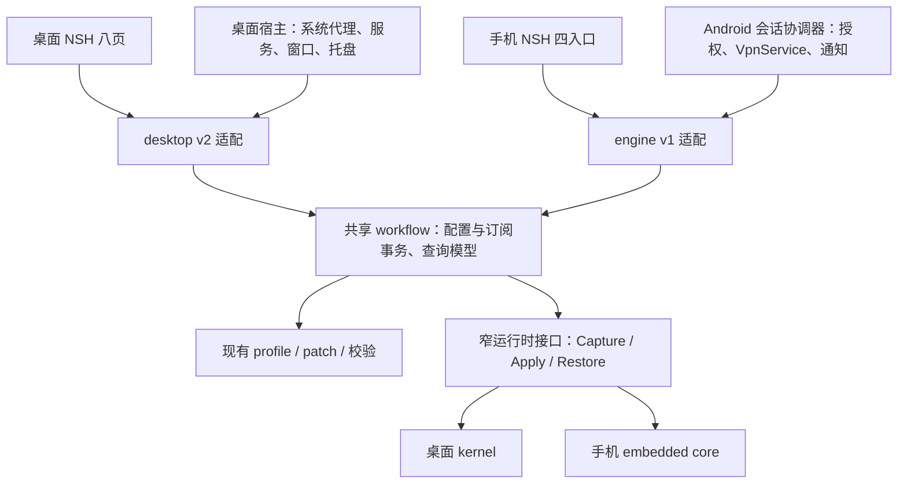

# Android 功能特化与共享业务层方案

调研日期：2026-11-08。下文分别记录实施进展与原始设计依据；当前已实现能力以实施进展和 README 为准。

## 2026-11-08 实施进展

下文保留调研时的现状作为设计依据；当前实现已推进到以下边界：

- 共享层 `internal/workflow` 已接入桌面与 SDK，包含配置 Apply/Commit/Restore、订阅 checked import/refresh 及 stage-only 策略；现有 `profile.Store` 补 context 下载与提交保护，桌面仍保留原协议、八页布局及系统集成。
- 手机 SDK 增加订阅编辑/更新/删除、忙任务与待重连状态。HTTP 下载和延迟测试不持状态全局锁，断开可取消在途操作。手选节点按订阅分别持久化，路由模式同样跨进程重启恢复；配置更新移除节点时回退默认并清理旧选择。保存失败保留原模式或恢复原节点，重开应用不会自动连接。
- Android 增加进程级 SessionController、操作代次、带版本/token 的 TunnelPlan；Activity 不拥有连接任务，状态事件与查询独立于下载队列。系统授权、FD、出站保护和前台通知继续归宿主。
- 手机使用连接/节点/订阅/设置四入口，支持模式、常用订阅管理、文件导入、诊断日志，以及所有/仅选中/排除选中应用范围。触控尺寸与窗口宽度解耦，新增轻柔页面过渡。
- Always-on、后台周期订阅更新、跨平台完整备份、按应用指定代理组、手机组网和正式签名分发仍属于后续工作；真机锁屏、蜂窝切换与厂商后台策略尚不能由模拟器验收替代。

测试命令、当前宿主能力及产物见 [原生客户端说明](README.md)；模拟器报告为构建时生成的 `../bin/native/android/test/last-result.json`。本文末尾的旧报告时间仅描述调研基线。

本轮验证（2026-11-08）：

| 检查 | 结果 |
| --- | --- |
| 完整 Go 回归 | `go test ./...` 通过；相关共享事务、profile 与并发定向 race 通过 |
| NSH 界面 | 类型检查通过，34 项手机/桌面交互回归通过；三尺寸明暗与编辑/日志实际 AppKit 截图已核验 |
| 桌面交付 | 原版及 NSH 应用包已更新；真实 helper 八页、本地流量、失败恢复、备份和正常退出通过，未请求系统网络变更 |
| C ABI | 实际导入、启用、节点选择、本地 SOCKS 流量、停止和关闭通过 |
| Android ARM 模拟器 | 真实 TUN、DIRECT/REJECT、流量、快速重连、迟到授权、慢下载时断开、include/exclude 应用范围、手选节点重连恢复通过；独立 UID 探针与宿主请求路径共同验证 |
| Android 产物与截图 | arm64/x86_64 开发 APK 均构建；ARM 报告成功且 SHA 与产物匹配，x86_64 仅编译/签名检查；六张实际 Android 截图已核验 |

已移除导致模拟器 Vulkan 驱动崩溃的 ShaderTransition，改用有限时长的普通视图动画；当前同一图形环境的完整 Android 回归通过。SDK 全量 race 仍有已记录的 mihomo 上游日志全局变量竞态，不能据此宣称所有竞态检查通过。真机后台、耗电、蜂窝切换和正式签名分发仍待验收。

同日后续：补齐路由模式与按订阅手选节点的跨进程持久化。完整 Go 回归 842 项、NSH 交互 34 项通过，新增偏好读写/损坏/链接检查的定向 race 通过；C ABI 本地流量通过。Android ARM 测试在不同进程 PID 下验证保存的 direct 模式与 REJECT 节点，建立真实 VPN 后依次验证直连、规则拦截与改选恢复，主 APK SHA-256 与报告一致。快速重连不再假定 Android 必须更换 Network ID，改查真实 DIRECT/REJECT 流量；探针使用独立 UID 的默认套接字，并在完整服务重连后等待新网络。arm64/x86_64 开发 APK 和 Mac Catalyst NSH 应用包已更新；x86_64 仍仅构建与签名检查。

本轮桌面真实 helper 的八页查询、本地流量、无效配置回滚、备份校验和正常退出也已重跑通过，未请求系统网络设置变更。六张实际 Android 截图已检查；专用临时模拟器在测试结束后关闭。

## 方向

Android 围绕可靠连接、切换节点、管理订阅组织产品。桌面保留八页和高级编辑体验；手机使用四个主入口，高级工具逐步加入次级页面。共享业务规则、配置事务和数据模型，界面布局、系统集成及连接生命周期按平台实现。

继续使用 NSH 与现有 Go 内核，无须为这次整理同时改写 Kotlin/Compose，也不宜把 Android 改成桌面的 helper 进程架构。初期保持应用进程内唯一引擎，服务拥有 VPN 会话，Activity 只是客户端。

## 当前代码已经具备什么

| 范围 | 现状与证据 | 下一步 |
| --- | --- | --- |
| 基础 VPN | `android/src/io/github/gopurr/nativeapp/GopurrVpnService.java` 已有系统授权检查、前台通知、TUN、撤权清理、断开和迟到操作保护；Activity 销毁不会主动断开 | 保留这些生命周期保障，补可观测状态和恢复路径 |
| 手机业务 | `../sdk/engine/engine.go` 支持状态、启停、模式、订阅导入/启用、节点选择/测速、日志 | 订阅编辑、删除、更新等尚未接齐；不能把桌面页面接上就视为完成 |
| 两套应用层 | `../internal/app/native_call.go` 仍构造小 `App` 复用桌面事务和编辑器；手机独立实现事务 | 抽出不依赖窗口、草稿、notice 的共享用例 |
| 真实语义差异 | SDK 活跃订阅重导入仅验证并保存，桌面会应用运行中配置；VPN 期间 SDK 禁止切换配置；节点切换关闭旧连接的策略也不同 | 显式区分保存、选择、应用、需要重连，保留各平台策略 |
| 状态与并发 | 手机页面统一 busy；Java 单 worker；SDK `Call` 持全局锁完成下载和测速 | 长任务可取消，状态查询读已提交快照，断开有独立优先通路 |
| 网络参数 | Java Builder 与 `../sdk/engine/vpn.go` 重复写 MTU、地址、DNS、IPv6 配置 | 建立版本化 `TunnelPlan` 单一来源 |
| UI | `ui/src/app.tsx` 四页集中在一个文件，宽度同时决定布局和触控密度，仍有桌面系统代理占位说明 | 分开平台、窗口尺寸与输入密度，按功能拆 store 和页面 |

现有 `internal/profile`、`internal/patch`、配置校验和安全文件处理已经可共享，不再为每个存储方法套一层同义接口。

## 手机功能取舍

| 主入口 | 首版目标 | 后续或次级入口 |
| --- | --- | --- |
| 连接 | 连接/断开、授权与异常状态、当前出口、规则/全局/直连、实时流量 | 连接详情、DNS、诊断；网络不可用与 VPN 是否建立分别显示 |
| 节点 | 策略组、搜索、选择、单节点及整组测速、排序 | 节点参数和策略组编辑 |
| 订阅 | URL、粘贴和文件导入，更新、重命名、修改来源、删除、明确切换与重连 | 配置预览、聚合和完整 YAML 编辑 |
| 设置 | 应用参与 VPN 的范围、主题/语言、通知、导入导出、诊断日志 | 快捷磁贴、规则和高级覆写、组网 |

不在 Android 展示系统代理、桌面 TUN 服务安装、托盘/Dock、全局快捷键、窗口退出策略等无对应能力的占位项。导入配置的规则仍可生效，不要求首版同时提供桌面级可视化规则编辑器。LAN 代理、远程 Web 管理等桌面开放能力不作为手机默认功能。

保留配色、Lucide 图标和必要动画；移动页面切换、底部面板、开关和流量曲线使用适合触控的节奏，并响应减少动态效果。手机全屏编辑、系统返回、键盘和安全区单独设计。平板可以双栏或导航轨，触控目标不能因窗口变宽缩为桌面尺寸。

## 共享边界

### 1. 先抽配置和订阅事务

最小新增 `internal/workflow`，先包含配置变更与订阅命令，随后按实际手机需求加入覆写、编辑模型和查询。`internal/app` 继续负责桌面 UI 和系统集成；`sdk/engine` 继续负责手机协议适配和嵌入运行时。保留现有 desktop v2、engine v1 对外契约，内部逐项迁移。

统一流程：预约任务并捕获不可变输入 → 下载/编译/校验 → 校验版本是否仍有效 → 按平台策略应用 → 提交存储 → 失败恢复。恢复点应包含配置、运行状态、模式和手选节点，不能只有 YAML。可以借用现有 `internal/app/override_change.go` 的窄回调结构。

读模型增加已保存版本、已应用版本和待应用状态。活跃订阅更新成功但尚未重连时，手机必须准确提示。公共用例接收明确的应用策略和节点切换策略，避免悄悄改变桌面关闭旧链路或手机禁止在线切配置的行为。

下载入口在现有 `profile` 包补 context 支持，保留大小限制、重定向/来源校验、UA 和代理策略。长耗时工作不持状态全局锁；配置提交仍串行，取消和断开独立可达。迟到结果通过任务编号、会话代次和配置版本校验后才能提交。

### 2. 平台运行时保持窄接口

共享层只依赖需要的配置应用、恢复和查询能力。系统代理、管理员服务、Dock、全局快捷键、VPN 权限、通知和安装更新分别留在宿主，避免一个庞大平台接口充斥 Unsupported 方法。

`TunnelPlan` 提供 MTU、地址/路由、DNS 和 IPv6 策略，同时用于 Android Builder 与 Go 配置编译，并携带配置版本以拒绝过期接入。FD 与 `protect(fd)` 仍由原生 ABI 传递和持有，不能成为普通 JSON 参数。保留先停核心再关闭宿主 TUN 的顺序。

移动端强制 loopback、剥离额外入站和禁用进程发现等策略继续是手机配置编译策略，不能反向施加到桌面，影响桌面的 LAN、进程分流和组网。

### 3. 契约、偏好和界面复用

- 共享类型化业务模型、错误码与任务状态；Go/TS 契约用生成或一致性测试防止手工漂移。协议适配器保留现有 envelope 与版本映射，前端保留错误码用于本地化和恢复动作。
- 拆出 portable、desktop、Android 偏好的投影，先保持桌面 prefs JSON 兼容。跨平台备份仅导入可移植字段，对机器路径、启动项、系统服务和平台专属参数说明跳过项。
- 文件导入导出在 Android 走系统文档 URI/流式读取接口，共享层接收有大小上限的内容，不假设能拿到桌面文件路径。
- 共享配色、图标、格式化、字段语义和业务 store；布局壳、路由、编辑器呈现和交互密度分别实现。手机不直接导入整套桌面弹窗组件。
- 连接状态以宿主快照与事件为准；恢复前台时重新同步。流量仅在可见页面按需采样，订阅与节点列表按变更刷新，替换每两秒轮询三套数据的方式。

## Android 必须单独处理的事项

### 会话状态与后台

原生 `SessionController` 负责未连接、等待授权、连接中、已连接、重配置中、停止中、已撤权和失败状态；底层网络可用性另行描述。Activity、通知和后续磁贴订阅同一状态并提交同一组命令，不各自维护“已连接”。UI reply 不拥有连接任务，页面重建后可重新订阅操作进度。

断开或撤权必须取消正在进行的连接与下载，旧授权回调或迟到任务不能重新连上。配置切换初期明确需要重连；后续加入断开、应用新配置、重连和失败恢复旧配置，不承诺无中断热切换。系统撤权后的恢复不能自动越过新授权。

每次连接遵循 `VpnService.prepare()`、出站保护、TUN 接入和撤权清理。Android 每用户/工作资料只有一个活跃 VPN，新的 VPN 会取代旧的；组网将来需评估与现有数据面共存，不通过第二个独立 VPN 服务简单叠加。[Android VPN 指南](https://developer.android.com/develop/connectivity/vpn)

当前 Manifest 使用 `systemExempted` 前台服务类型；官方允许条件包括已在系统设置配置的 VPN 应用，仍须核对 API 级别和启动时序，不能将此类型理解为通用后台豁免。[前台服务类型](https://developer.android.com/develop/background-work/services/fgs/service-types)

通知权限和 VPN 授权分别处理。拒绝 `POST_NOTIFICATIONS` 不等于拒绝 VPN，也不能据此直接禁止启动前台服务；服务仍须提交前台通知。补通知权限的场景引导与无通知抽屉时的真实状态反馈。[通知运行时权限](https://developer.android.com/develop/ui/compose/notifications/notification-permission)

当前已明确关闭 Always-on，且服务为 `START_NOT_STICKY`。首版保持显式连接；完成进程重建、重启、升级和系统 lockdown 验证后，再开放始终开启。快捷磁贴可较早加入，但只调用同一连接协调器。[TileService](https://developer.android.com/reference/android/service/quicksettings/TileService)

### 应用范围与分流

首版“所有应用 / 仅选中应用 / 排除选中应用”表示哪些应用的流量进入 VPN；与“给某应用指定代理组、直连或拦截”分别命名、分别建模。

Builder 的 allowed 与 disallowed 列表不可混用。当前固定排除 Gopurr 自身；实现仅选中模式时，不能再无条件调用自身 disallow。过滤自身和未安装包后若没有有效选择，应拒绝建立或要求重新选择，不能退化为未调用 allowed API 而接管所有应用。修改应用范围需要重建连接。[VpnService.Builder](https://developer.android.com/reference/android/net/VpnService.Builder)

桌面可执行路径规则不能映射成 Android 包规则。真正按应用指定代理组还需要连接归属识别、UID/包名映射和内核规则接入；系统 `getConnectionOwnerUid` 从 API 29 提供，而目前 minSDK 为 28，需要单独决定兼容策略。[ConnectivityManager](https://developer.android.com/reference/android/net/ConnectivityManager#getConnectionOwnerUid(int,%20java.net.InetSocketAddress,%20java.net.InetSocketAddress))

应用选择器还要验证包可见性与分发政策，按所需查询声明设计，不默认申请广泛包查询权限。[Package visibility](https://developer.android.com/training/package-visibility/declaring)

### 网络切换、更新与发布

现有 `setUnderlyingNetworks` 只是向系统报告承载网络，不能据此宣称旧连接已迁移或断网恢复成功。需实测 Wi-Fi/蜂窝切换、IPv4/IPv6、DNS、无网络和认证网络；计费属性也不应长期无条件设置为非计费。[VpnService API](https://developer.android.com/reference/android/net/VpnService#setUnderlyingNetworks(android.net.Network%5B%5D))

订阅后台更新复用共享更新用例，由 Android WorkManager 按网络/电量等约束调度，不依赖页面 JS 或长期 Go ticker；周期任务并非精确计时器。[WorkManager 任务定义](https://developer.android.com/develop/background-work/background-tasks/persistent/getting-started/define-work)

当前脚本适合工具链与 VPN 验证，仍是 debug Manifest、开发证书和固定 versionCode。正式交付前建议加入标准 Gradle 模块与 debug/release 变体，以接入依赖、资源、Manifest 和检查流程；继续保留 NSH 与 JNI，不要求改写 UI 框架。

Android 需要独立、长期保存的 APK 签名证书和递增版本；Mac 整包更新的 Ed25519 密钥不能代替 APK 签名。是否通过 GitHub APK 或 Play 分发将影响发布、签名与更新适配器，业务层不绑定下载渠道。[Android 应用签名](https://developer.android.com/studio/publish/app-signing)

## 实施顺序与验收

| 阶段 | 工作 | 验收条件 |
| --- | --- | --- |
| A：事务收敛 | 固定现有协议与保存/生效语义；抽配置变更、订阅事务及可取消下载，先接桌面再接 SDK | 桌面现有行为、回滚和关闭忙任务测试保持；同一组用例在两种运行时验证，无重复新事务 |
| B：连接基础 | Android 会话协调器、TunnelPlan、事件/快照、取消与撤权；状态查询不被长任务堵住 | 授权取消、重复点击、迟到回调、断开优先、Activity 重建、失败恢复、FD 所有权均可验证 |
| C：手机特化 | 四入口、订阅完整常用操作、模式/日志、应用范围、文件导入导出、通知及磁贴 | 小屏、平板、安全区、键盘、系统返回、长文本和状态动画；截图及实际 Android 宿主核验 |
| D：真机与发布 | 后台恢复、网络/电量策略、正式构建签名与数据升级；随后评估 Always-on、组网、高级编辑 | 真机长时间运行和版本升级通过后开放对应能力 |

自动验证继续使用独立应用 UID 的流量探针：Gopurr 自身被排除在 VPN 外，只用本应用或 shell 发请求会产生错误的通过结果。保留真实 TUN、DIRECT/REJECT、节点切换、计数、重连测试，增加应用范围为空/卸载/互斥、长下载时断开、配置应用失败恢复等场景。

真机矩阵覆盖 API 28、34、36 等目标版本及至少一种有后台限制的系统：锁屏、进程终止/重建、Wi-Fi/蜂窝切换、IPv6/DNS、系统撤权、被其他 VPN 替代、拒绝通知、低电量与升级。模拟器不能代替这些验收；API 28 是否继续支持取决于后续数据，不在本次调研擅自提高最低版本。

仓库已有模拟器报告 `../bin/native/android/test/last-result.json`：2026-11-07 22:22:48（Asia/Shanghai）开始，结果成功，包含 JNI、真实 TUN、DIRECT/REJECT、流量与重连。此次仅核对报告，未重新执行测试。SDK README 记录的上游日志级别竞态仍须保留跟踪，不能因桌面测试通过而视为消失。

后续产品决策：GitHub APK / Play 的分发优先级、组网在手机上的优先级、是否需要真正的按应用指定代理组。这些不阻塞先完成 A、B 阶段。
